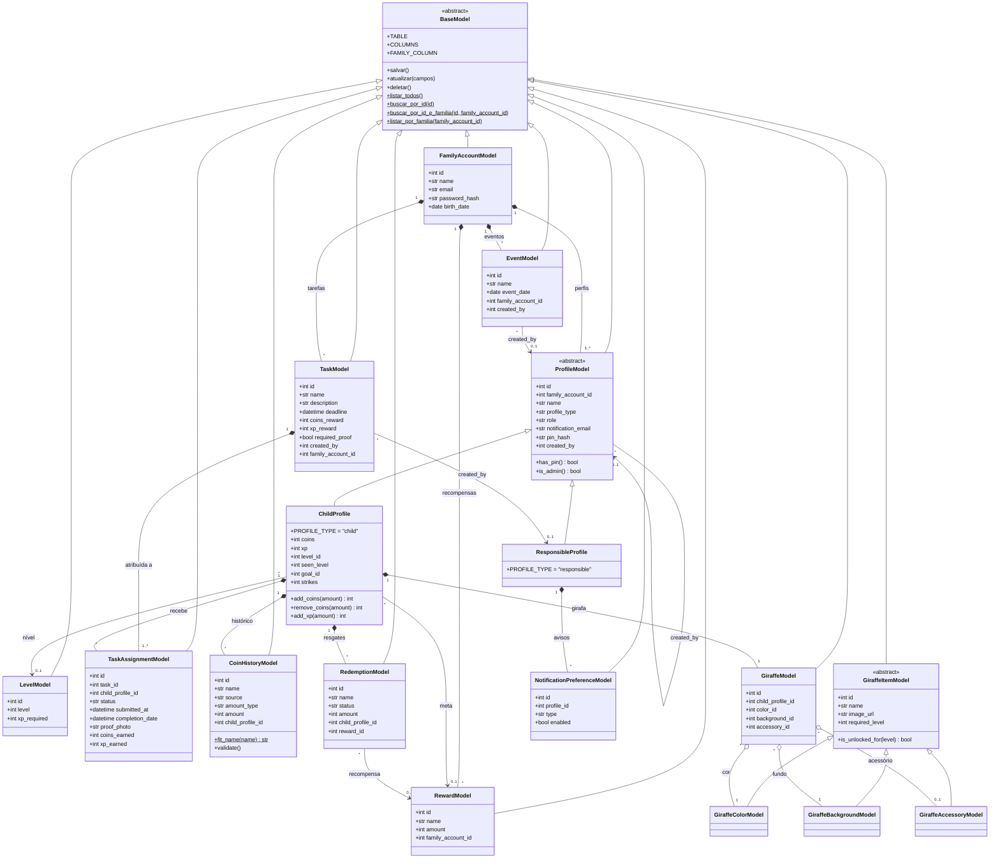

# Diagrama de classes do domínio

Classes de `backend/models/` e as ligações entre elas. Cada Model corresponde a uma tabela de `backend/database/schema.sql`.

- **Herança** (`<|--`): todas as Models herdam de `BaseModel`, que tem o CRUD (`salvar`, `atualizar`, `deletar`, `listar_todos`, `buscar_por_id`). `ChildProfile` e `ResponsibleProfile` herdam de `ProfileModel` e ficam na mesma tabela (`profiles`), separados por `profile_type`. Os três itens da girafa herdam de `GiraffeItemModel`.
- **Composição** (`*--`): a parte não existe sem o todo. Apagar a conta família apaga os perfis, as tarefas, as recompensas e os eventos dela. Apagar uma criança apaga a girafa, o histórico de moedas e os resgates dela (`ON DELETE CASCADE`).
- **Agregação** (`o--`): o item existe sozinho e só é usado pelo todo. Por exemplo, a girafa usa uma cor, um fundo e um acessório do catálogo, mas os itens continuam existindo sem ela.
- **Associação** (`-->`): é só uma referência (`ON DELETE SET NULL`), como o nível da criança, a meta, a recompensa de um resgate e quem criou cada registro.

## Camadas que usam as Models

As Models só fazem o CRUD da própria tabela. As outras camadas do backend usam as Models assim:

| Camada | Pasta | Papel |
|---|---|---|
| Controller | `backend/controllers/` | Uma classe por recurso (herda de `BaseController`). Lê a requisição, chama o Service e responde. |
| Service | `backend/services/<domínio>/` | Uma classe por ação, com o método `execute`. Valida e coordena usando Models e Repositories. |
| Repository | `backend/repositories/` | Só consultas especiais: joins, filtros, paginação, relatório e `SELECT ... FOR UPDATE`. |
| Integração externa | `backend/services/email/send_email_service.py` | `SendEmailService` é o único que fala com o SMTP do Gmail. |
